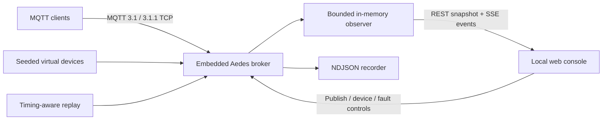

# MQTT PocketLab

**A local-first MQTT laboratory you can carry in one Node.js project.** Start an embedded broker, observe every message in a live web console, simulate deterministic IoT devices, inject failures, and turn real traffic into replayable NDJSON.

[简体中文](README.zh-CN.md) · [Contributing](CONTRIBUTING.md) · [Security](SECURITY.md)

> MQTT PocketLab is designed for development, teaching, demos, CI fixtures, and incident reproduction—not as a production Internet-facing broker.

## Why PocketLab?

IoT work often starts with five terminals, a remote broker, hand-written JSON, and hardware that happens to be somewhere else. PocketLab gives the whole team one reproducible workspace:

- **One-command lab:** embedded Aedes broker and responsive web console with `mqtt-pocketlab start`.
- **Live observability:** topics, payload previews, QoS, retained state, clients, message rate, bytes per second, and the last 100 messages over SSE.
- **Useful virtual devices:** deterministic climate, CO₂/air-quality, and electricity-meter models with stable seeds.
- **Failure on demand:** temporary disconnects, timing jitter, and abnormal sensor spikes from the UI or REST API.
- **Portable evidence:** byte-preserving UTF-8/binary NDJSON for accepted messages, bounded recording, visible drop counts, and timing-preserving replay at `0.05×`–`100×`.
- **Safe defaults:** binds only to `127.0.0.1`, caps payloads and topic depth, reserves `$SYS/`, and requires credentials before remote binding.
- **No frontend toolchain:** the console is served as static HTML/CSS/JavaScript; the npm package builds with TypeScript alone.

## Quick start

Requirements: **Node.js 22 or newer** (Node.js 24 LTS recommended).

```bash
git clone https://github.com/Guiiat/mqtt-pocketlab.git
cd mqtt-pocketlab
npm ci
npm run build
npm link
mqtt-pocketlab start --scenario smart-home
```

Open [http://127.0.0.1:3000](http://127.0.0.1:3000). The MQTT endpoint is `mqtt://127.0.0.1:1883`.

For repository development, skip `npm link` and run:

```bash
npm run dev -- --scenario greenhouse
```

## A 60-second tour

1. Run `mqtt-pocketlab start --scenario smart-home --record recordings/tour.ndjson`.
2. Watch three deterministic devices appear in **Virtual device fleet**.
3. Publish a message to `demo/hello` in the workbench.
4. Click **Spike** on the climate sensor and see the abnormal reading immediately.
5. Stop the recording, then replay it from the console at `5×` speed.
6. Re-run with the same seed: sensor values follow the same sequence, making bugs reproducible.

## CLI

```text
mqtt-pocketlab start [options]       embedded broker + web console
mqtt-pocketlab device <type>         one standalone deterministic device
mqtt-pocketlab record <file>         subscribe and record any MQTT broker
mqtt-pocketlab replay <file>         replay NDJSON against any MQTT broker
mqtt-pocketlab scenarios             list built-in fleets
```

Examples:

```bash
# Local lab with a fast factory scenario
mqtt-pocketlab start --scenario micro-factory

# Standalone CO₂ device against an existing MQTT 3.1.1 broker
mqtt-pocketlab device co2 --id office-air --seed 2026 \
  --broker mqtt://127.0.0.1:1883 --interval 1000

# Capture only telemetry, then replay ten times faster
mqtt-pocketlab record recordings/run.ndjson --topic "factory/+/telemetry"
mqtt-pocketlab replay recordings/run.ndjson --speed 10
```

Run `mqtt-pocketlab <command> --help` for every option.

`start` and `record` default to a **100 MiB per-session recording limit**. Change it with
`--max-recording-mib` on `start` or `--max-size-mib` on `record`. For wildcard remote listeners,
use `--advertise-host <hostname-or-ip>` so the CLI and API show an address clients can reach.

## Built-in scenarios

| ID | Fleet | Good for |
| --- | --- | --- |
| `smart-home` | Climate + CO₂ + main meter | Tutorials and dashboard demos |
| `greenhouse` | Two climate zones + CO₂ + irrigation meter | Rules, alerts, and time-series pipelines |
| `micro-factory` | Two fast meters + cabinet climate + workshop air | Throughput, fault, and replay testing |

Virtual devices publish telemetry to:

```text
pocketlab/devices/<device-id>/telemetry
pocketlab/devices/<device-id>/status       # retained online/offline state
```

Sample climate message:

```json
{
  "deviceId": "living-room",
  "type": "climate",
  "sequence": 12,
  "ts": "2026-08-03T06:00:00.000Z",
  "fault": null,
  "temperatureC": 23.8,
  "humidityPct": 59.1,
  "batteryPct": 97.98
}
```

The seed determines generated values; timestamps remain real wall-clock time. A **spike** multiplies relevant sensor values for a bounded number of readings, **jitter** varies publish delays for a bounded duration, and **disconnect** closes and later recreates the MQTT session.

## Record format

Each line is an independently parseable JSON object, so recordings remain streamable and Git-friendly:

```json
{"ts":1785722400000,"iso":"2026-08-03T06:00:00.000Z","topic":"demo/climate","payload":"{\"temperatureC\":22.4}","encoding":"utf8","qos":0,"retain":false,"clientId":"demo-sensor"}
```

Binary MQTT payloads are stored as Base64 with `"encoding":"base64"`; replay reconstructs the original bytes. Timing is based on adjacent `ts` values and divided by the requested speed multiplier. See [`examples/demo-recording.ndjson`](examples/demo-recording.ndjson).

The 100 MiB limit counts bytes written by one recording session. Files are opened in append mode, so
an existing file can be larger than that across multiple sessions. If disk backpressure occurs,
PocketLab drops new records instead of growing memory without bound; the API, SSE state, web badge,
warnings, and standalone CLI summary expose the drop count. A recording with drops is intentionally
not described as lossless.

## HTTP and SSE API

The console uses the same documented local API available to scripts:

All mutation requests (`POST`, `PUT`, `PATCH`, and `DELETE`) require
`Content-Type: application/json`. Browser mutations must be same-origin, and every request must use
the configured listener/advertised Host and web port. These checks protect the local lab from CSRF
and DNS-rebinding pages. Recording start requests must include an explicit simple `.ndjson` filename.

| Method | Path | Purpose |
| --- | --- | --- |
| `GET` | `/api/state` | Complete bounded broker snapshot |
| `GET` | `/api/events` | `text/event-stream` live events |
| `POST` | `/api/publish` | Publish UTF-8 payload, QoS, and retain flag |
| `POST` | `/api/devices` | Start a `climate`, `co2`, or `meter` device |
| `DELETE` | `/api/devices/:id` | Stop a virtual device |
| `POST` | `/api/devices/:id/fault` | Inject `disconnect`, `jitter`, or `spike` |
| `GET` | `/api/scenarios` | List example fleets |
| `POST` | `/api/scenarios/:id/start` | Start one example fleet |
| `POST` | `/api/recording/start` | Start a recording under `./recordings` |
| `POST` | `/api/recording/stop` | Flush and close the current recording |
| `POST` | `/api/replay/start` | Replay a file under `./recordings` |
| `POST` | `/api/replay/stop` | Abort replay cleanly |
| `GET` | `/health` | Lightweight process health |

```bash
curl -X POST http://127.0.0.1:3000/api/devices \
  -H "content-type: application/json" \
  -d '{"type":"climate","id":"lab-01","seed":42,"intervalMs":1000}'

curl -X POST http://127.0.0.1:3000/api/devices/lab-01/fault \
  -H "content-type: application/json" \
  -d '{"kind":"jitter","durationMs":15000,"jitterMs":750}'
```

## Architecture



The web console never connects directly to MQTT. This keeps browser dependencies at zero and gives the server one place to enforce payload, path, and authentication boundaries.

## Security model

- Default MQTT and HTTP listeners bind to `127.0.0.1` only.
- A non-loopback `--host` is rejected unless `--allow-remote`, username, and password are all present.
- Set credentials with `MQTT_POCKETLAB_USERNAME` and `MQTT_POCKETLAB_PASSWORD` to avoid shell-history exposure.
- The same environment variables work with `device`, `record`, and `replay`. Prefer them over
  `--password`, and do not put credentials in `--broker` URL userinfo; command-line arguments may be
  visible in shell history and process listings.
- Remote mode uses HTTP Basic and MQTT username/password, but **does not add TLS**. Use only on a trusted isolated network. The `0.1.x` same-origin guard does not support publishing the console behind an HTTPS-terminating reverse proxy; prefer an SSH port-forward back to the loopback listener.
- Client publishes are capped at 1 MiB; recording sessions default to 100 MiB; console previews are capped at 8 KiB; topic depth, queues, keepalive, clients, cached topics, and SSE clients (32) are bounded.
- Client publication to `$SYS/` is rejected. Recording/replay filenames from the web API cannot escape `./recordings`.

Read [`SECURITY.md`](SECURITY.md) before exposing the lab beyond your machine.

## Develop and verify

```bash
npm ci
npm run check       # strict typecheck + tests + production build
npm run test:watch
```

The integration suite starts the real broker and web server on ephemeral ports, connects with MQTT.js, publishes retained QoS messages, controls a virtual device, and exercises recording endpoints. CI runs the same check on Windows, macOS, and Linux using Node.js 22 and 24.

## Scope and roadmap

PocketLab currently speaks MQTT 3.1/3.1.1 because that is what the embedded broker supports. Natural follow-ups include WebSocket MQTT, JSON Schema assertions, saved dashboard layouts, and Docker images. Contributions should keep the local-first, dependency-light, deterministic design intact.

## License

[MIT](LICENSE) © MQTT PocketLab contributors.
