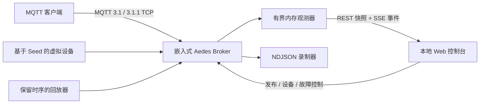

# MQTT PocketLab

**一个可以装进口袋的、本地优先 MQTT 实验室。** 一条命令启动嵌入式 Broker 和实时 Web 控制台；模拟可复现的物联网设备；注入断连、抖动和异常峰值；把真实消息录成可倍速回放的 NDJSON。

[English](README.md) · [参与贡献](CONTRIBUTING.md) · [安全策略](SECURITY.md)

> MQTT PocketLab 适用于开发、教学、演示、CI 测试夹具和故障复现，不应被当作面向公网的生产 Broker。

## 它解决什么问题

物联网调试经常需要同时打开多个终端、连接远程 Broker、手写 JSON，还得等待一块不在手边的硬件。PocketLab 把这一切收进一个可复现的工作台：

- **一条命令开实验室：** `mqtt-pocketlab start` 同时启动 Aedes Broker 和响应式控制台。
- **实时可观测：** 查看 Topic、Payload 预览、QoS、Retain、在线客户端、每秒消息数、吞吐量和最近 100 条消息。
- **真正有用的虚拟设备：** 温湿度、CO₂/空气质量、电表三类模型；固定 Seed 即可复现数值序列。
- **主动制造故障：** 在页面或 REST API 中注入临时断连、发送抖动、传感器异常峰值。
- **可携带的现场证据：** 对成功写入的 UTF‑8/二进制消息保持字节一致，限制录制容量、明确显示丢弃数，并以 `0.05×`–`100×` 保留相对时序回放。
- **默认安全：** 仅监听 `127.0.0.1`，限制 Payload 与 Topic 深度，保护 `$SYS/`；远程监听必须显式开启且提供账号密码。
- **前端零构建：** 控制台使用原生 HTML/CSS/JavaScript，整个 npm 包只需 TypeScript 编译。

## 快速开始

需要 **Node.js 22 或更高版本**，推荐 Node.js 24 LTS。

```bash
git clone https://github.com/Guiiat/mqtt-pocketlab.git
cd mqtt-pocketlab
npm ci
npm run build
npm link
mqtt-pocketlab start --scenario smart-home
```

浏览器打开 [http://127.0.0.1:3000](http://127.0.0.1:3000)，MQTT 地址为 `mqtt://127.0.0.1:1883`。

在仓库内开发时，不执行 `npm link` 也可以：

```bash
npm run dev -- --scenario greenhouse
```

## 60 秒体验完整能力

1. 执行 `mqtt-pocketlab start --scenario smart-home --record recordings/tour.ndjson`。
2. 在“虚拟设备”区域看到 3 台设备上线并持续发送数据。
3. 在发布工作台向 `demo/hello` 发送一条消息。
4. 对温湿度设备点击 **Spike**，立刻观察异常读数。
5. 停止录制，再从页面用 `5×` 速度回放。
6. 使用相同 Seed 再运行一次，传感器数值会遵循相同序列，Bug 因而可以复现。

## CLI 命令

```text
mqtt-pocketlab start [options]       嵌入式 Broker + Web 控制台
mqtt-pocketlab device <type>         单独运行一台确定性虚拟设备
mqtt-pocketlab record <file>         订阅任意 MQTT Broker 并录制
mqtt-pocketlab replay <file>         向任意 MQTT Broker 回放 NDJSON
mqtt-pocketlab scenarios             列出内置场景
```

示例：

```bash
# 启动高频微型工厂
mqtt-pocketlab start --scenario micro-factory

# 向现有 MQTT 3.1.1 Broker 连接一台 CO₂ 设备
mqtt-pocketlab device co2 --id office-air --seed 2026 \
  --broker mqtt://127.0.0.1:1883 --interval 1000

# 只录制遥测 Topic，然后以 10 倍速度回放
mqtt-pocketlab record recordings/run.ndjson --topic "factory/+/telemetry"
mqtt-pocketlab replay recordings/run.ndjson --speed 10
```

使用 `mqtt-pocketlab <command> --help` 查看所有选项。

`start` 与 `record` 每次录制默认最多 **100 MiB**。`start` 可通过 `--max-recording-mib` 调整，
`record` 可通过 `--max-size-mib` 调整。远程监听通配地址时，可用
`--advertise-host <主机名或IP>` 让 CLI 和 API 显示客户端实际可访问的地址。

## 内置场景

| ID | 设备组合 | 适用场景 |
| --- | --- | --- |
| `smart-home` | 温湿度 + CO₂ + 总电表 | 入门教学、仪表盘演示 |
| `greenhouse` | 两个温湿度分区 + CO₂ + 灌溉电表 | 规则引擎、告警和时序管道 |
| `micro-factory` | 两个高频电表 + 机柜温湿度 + 车间空气 | 吞吐、故障和回放测试 |

设备会发布到：

```text
pocketlab/devices/<device-id>/telemetry
pocketlab/devices/<device-id>/status       # Retain 的在线/离线状态
```

温湿度消息示例：

```json
{
  "deviceId": "living-room",
  "type": "climate",
  "sequence": 12,
  "ts": "2026-08-03T06:00:00.000Z",
  "fault": null,
  "temperatureC": 23.8,
  "humidityPct": 59.1,
  "batteryPct": 97.98
}
```

Seed 决定生成的数值，时间戳仍使用真实时间。**Spike** 会在限定条数内放大关键读数，**Jitter** 会在限定时间内随机改变发送间隔，**Disconnect** 会主动关闭 MQTT 会话并在到期后重建连接。

## 录制格式

每行都是一个独立 JSON 对象，既能流式处理，也适合放进 Git：

```json
{"ts":1785722400000,"iso":"2026-08-03T06:00:00.000Z","topic":"demo/climate","payload":"{\"temperatureC\":22.4}","encoding":"utf8","qos":0,"retain":false,"clientId":"demo-sensor"}
```

二进制 Payload 以 Base64 保存并标记 `"encoding":"base64"`，回放时会恢复原始字节。回放间隔取相邻记录的 `ts` 差值，再除以速度倍率。完整示例见 [`examples/demo-recording.ndjson`](examples/demo-recording.ndjson)。

100 MiB 上限只统计单次录制会话新写入的字节。文件使用追加模式，因此经过多次会话后，已有文件
可以大于该上限。磁盘出现背压时，PocketLab 会丢弃新记录，避免内存无界增长；API、SSE 状态、
页面徽标、告警和独立 CLI 摘要都会显示丢弃数。发生丢弃的录制不会被宣称为“无损”。

## HTTP / SSE API

页面自身也使用这套本地 API，因此脚本可以直接调用：

所有变更请求（`POST`、`PUT`、`PATCH`、`DELETE`）都必须使用
`Content-Type: application/json`。浏览器变更请求必须同源，所有请求的 Host 和端口也必须匹配
已配置的监听/通告地址，用于阻止 CSRF 与 DNS rebinding。开始录制时必须显式提供简单的
`.ndjson` 文件名。

| 方法 | 路径 | 用途 |
| --- | --- | --- |
| `GET` | `/api/state` | 获取有界的 Broker 完整快照 |
| `GET` | `/api/events` | 订阅 `text/event-stream` 实时事件 |
| `POST` | `/api/publish` | 发布 UTF‑8 Payload、QoS 和 Retain |
| `POST` | `/api/devices` | 启动 `climate`、`co2` 或 `meter` |
| `DELETE` | `/api/devices/:id` | 停止虚拟设备 |
| `POST` | `/api/devices/:id/fault` | 注入 `disconnect`、`jitter` 或 `spike` |
| `GET` | `/api/scenarios` | 列出示例设备群 |
| `POST` | `/api/scenarios/:id/start` | 启动示例设备群 |
| `POST` | `/api/recording/start` | 在 `./recordings` 下开始录制 |
| `POST` | `/api/recording/stop` | 刷盘并关闭当前录制 |
| `POST` | `/api/replay/start` | 回放 `./recordings` 下的文件 |
| `POST` | `/api/replay/stop` | 安全终止回放 |
| `GET` | `/health` | 轻量健康检查 |

```bash
curl -X POST http://127.0.0.1:3000/api/devices \
  -H "content-type: application/json" \
  -d '{"type":"climate","id":"lab-01","seed":42,"intervalMs":1000}'

curl -X POST http://127.0.0.1:3000/api/devices/lab-01/fault \
  -H "content-type: application/json" \
  -d '{"kind":"jitter","durationMs":15000,"jitterMs":750}'
```

## 架构



浏览器不会直接建立 MQTT 连接，这既省掉了浏览器端依赖，也让服务器能够统一执行 Payload、路径与认证边界。

## 安全模型

- MQTT 与 HTTP 默认只监听 `127.0.0.1`。
- 非回环 `--host` 必须同时提供 `--allow-remote`、用户名和密码，否则拒绝启动。
- 推荐通过 `MQTT_POCKETLAB_USERNAME` 和 `MQTT_POCKETLAB_PASSWORD` 设置凭据，避免密码进入 Shell 历史。
- `device`、`record`、`replay` 同样支持这两个环境变量。优先使用环境变量，不建议使用
  `--password`，也不要把账号密码放进 `--broker` URL 的 userinfo；命令行参数可能出现在 Shell
  历史与进程列表中。
- 远程模式使用 HTTP Basic 和 MQTT 用户名/密码，但**没有自动添加 TLS**，只能用于可信隔离网络。`0.1.x` 的同源防护不支持把控制台发布在终止 HTTPS 的反向代理后；建议用 SSH 端口转发继续访问回环监听。
- 客户端发布上限为 1 MiB；每次录制默认上限 100 MiB；页面预览上限 8 KiB；Topic 深度、队列、Keepalive、客户端、缓存 Topic 与 SSE 客户端（32 个）都有边界。
- 客户端不能发布 `$SYS/`；Web API 中的录制/回放文件名不能逃逸 `./recordings`。

准备让其他机器访问前，请先阅读 [`SECURITY.md`](SECURITY.md)。

## 开发和验证

```bash
npm ci
npm run check       # 严格类型检查 + 测试 + 生产构建
npm run test:watch
```

集成测试会在随机端口启动真实 Broker 与 Web 服务，通过 MQTT.js 连接、发送带 Retain 的 QoS 消息、控制虚拟设备并验证录制接口。GitHub Actions 会在 Windows、macOS、Linux 的 Node.js 22/24 上运行同一套检查。

## 当前边界与后续方向

嵌入式 Broker 当前支持 MQTT 3.1/3.1.1，因此项目不会虚假宣称 MQTT 5。后续可以增加 WebSocket MQTT、JSON Schema 断言、仪表盘布局保存和 Docker 镜像。新功能应继续保持“本地优先、依赖克制、结果可复现”的设计原则。

## 许可证

[MIT](LICENSE) © MQTT PocketLab contributors.
